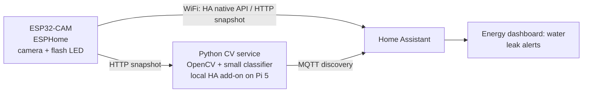

# ESP32-CAM Water Meter Reader – Development Plan

> Archive note (2026-11-07): use the [archive project map and shared tooling](../../README.md).
> This plan preserves historical commands/paths. Firmware is now in
> `projects\esphome\espcam-water`, HA config in `projects\home-assistant\water_meter`,
> and CAD in `projects\hardware\espcam-water`. Do not recreate per-project ESPHome venvs.

## What the images show

- Siemens wet-dial water meter in a floor pit, hinged lid.
- **5-digit roller counter** (m³), currently `00705`.
- **4 red-pointer dials** for ×0.1, ×0.01, ×0.001, ×0.0001 m³ (resolution 0.1 L).
- **Star wheel / flow indicator**, useful for leak detection.
- Glass dome is scratched and reflective, so glare from the on-board flash will be the main imaging problem.
- The lid has to stay open or be removed, so the camera holder will replace or sit under the lid.

## Architecture (decided: ESPHome + local HA add-on on the Pi 5)



- **Device: ESPHome (ESP-IDF)**. It handles WiFi, OTA, the HA native API, flash LED control and the camera snapshot endpoint. It needs no custom firmware code.
- **Vision: off-device Python service**. With OpenCV it is easy to iterate on and debug, and it can be retrained. It publishes the meter reading to HA with MQTT discovery (`device_class: water`, `state_class: total_increasing`, unit `m³`).
- **Rejected:** *AI-on-the-edge-device*. It needs an SD card, which wears out and is a known source of compatibility problems on the ESP32-CAM, and it reads only every ~3 min. Its open-source digit/pointer models can still be reused in the add-on.

## Existing Home Assistant environment

- HAOS on a Raspberry Pi 5, booting from NVMe.
- Seven YAML **packages** (`/config/packages/`, each with a `dashboard_*.yaml`): airco, bathroom radiator, bathroom ventilation, EV battery health, EV charging, floor heating monitor, lighting.
  - They are all event-driven template logic with no heavy computation. The vision add-on (~0.1–0.3 % of one core on average) won't interfere with them.
- **MQTT broker already in use** (Faikout airco, Itho CVE, Ring). The add-on reuses it, and gets the broker credentials from the Supervisor (`services: mqtt:need`), so no credentials need to be stored.
- **ESPHome integration already in use** (floor heating monitor), so the camera device is adopted the same way.
- Conventions to follow:
  - One folder per feature, containing `<name>.yaml` package + `dashboard_<name>.yaml`.
  - Entity-ID mapping is documented in the YAML header.
  - Helpers have **no initial values**, so tuning survives restarts.
  - Use relative/adaptive thresholds instead of absolute ones.
  - Python 3.13 + pytest, with `pytest_homeassistant_custom_component` for package behaviour tests (as in `ev_battery_health`).
  - Windows `.bat` helpers for the dev environment.

## Repository layout (planned)

```
esphome/                     ESPHome device configs (+ secrets.yaml, git-ignored)
cv/                          vision pipeline, dataset tools, pytest suite (runs on laptop)
addon/water_meter_reader/    HA local add-on: config.yaml, Dockerfile, service code
ha/water_meter/              water_meter.yaml package + dashboard_water_meter.yaml + tests
dataset/                     captured images + labels (git-ignored)
```

## Environment status (checked)

- Board on **COM49** (USB serial).
- Python 3.12 / 3.13 are installed. **ESPHome is not installed** yet.
- `c:\esphome-idf` holds the ESP-IDF 5.5 framework/tool cache, but `idf-env.json` lists only S2/S3 targets. ESPHome should fetch the plain `esp32` toolchain on the first build.

---

## Phase 0 – Toolchain
1. Create a venv in the repo with `py -3.12 -m venv .venv-esphome`, then run `.venv-esphome\Scripts\python -m pip install esphome` (ESPHome 2026.10.2 installed).
2. Copy `esphome/secrets.yaml.example` to `esphome/secrets.yaml` and fill in the WiFi credentials.
3. Run `esphome config esphome/step1-board-test.yaml` to check that the config validates.

## Phase 1 – Board & flash LED verification  *(first milestone)*
Config: [esphome/step1-board-test.yaml](esphome/step1-board-test.yaml)

1. Flash over serial with `esphome run esphome/step1-board-test.yaml --device COM49`.
   - If the upload doesn't start, hold **IO0 to GND / BOOT** and press **RST**. Most ESP32-CAM-MB boards switch into flash mode automatically.
2. Check the following:
   | Check | Expected |
   |---|---|
   | Serial log | Boot OK, no brownout resets |
   | PSRAM | ~4 MB reported (needed for camera) |
   | Red status LED (GPIO33) | Blinks once per second (heartbeat) |
   | Flash LED (GPIO4) | Pulses briefly at boot; dimmable from the web UI |
   | WiFi | Connects; RSSI sensor reported |
   | Web UI `http://espcam-water.local` | Flash LED on/off/brightness works |
3. Do the power check: run the flash at 100 % for 10 s while WiFi is active, and confirm the board doesn't reset. If it does, use a better 5 V supply (≥1 A).
4. Do a later OTA update to confirm that wireless flashing works, so USB is no longer needed.

**Result (2026-11-04): PASSED.**
- Board: ESP32-D0WD rev 1.0, 4 MB flash.
- PSRAM: 4.19 MB free.
- Network: IP `192.168.68.76`, RSSI -40 dBm on the desk.
- LEDs: heartbeat LED and the flash pulse at boot are both OK.
- Power: 10 s at 100 % flash caused no reset.
- OTA: encrypted wireless update OK.
- Serial flashing needs manual boot mode (IO0 to GND + RST) on this adapter.

## Phase 2 – Camera bring-up
- Add `esp32_camera` (AI-Thinker pinout) plus `esp32_camera_web_server` (snapshot on port 8081).
- Add the device to HA using the ESPHome integration, and check the live view and snapshot.
- Use the flash with each capture: switch the LED on, wait ~200 ms, capture, switch it off. Expose this as an ESPHome button/script.
- Tune resolution (start at 1024×768 or 800×600), JPEG quality, AEC/AGC, and whether the flash gives more or less glare than ambient light.

**Status (2026-11-04):**
- Config: [esphome/espcam-water.yaml](esphome/espcam-water.yaml). Snapshot on `:8081`, stream on `:8080`. The flash LED switches off automatically after 15 s.
- The camera sensor **only initialises with XCLK at 10 MHz**. At 20 MHz it fails with `ESP_ERR_NOT_SUPPORTED`.
- The lens is fixed-focus (glued) and sharp at ~15 cm, and 15 cm fits in the pit, so the camera runs at **1600×1200**: ~68 KB per JPEG, ~1.0 s per snapshot and ~2.6 s with flash.
- The images have a strong purple/blue cast (white balance, or a missing IR filter). Check this on the meter; it matters for detecting the red pointers.
- Capture tool: `tools/capture.py --brightness 255 --settle 1.5`. Images are saved to `dataset/raw/`, which is git-ignored.

**Meter test at 15 cm (2026-11-04):**
- **Focus:** OK. The digits are crisp and the dial numerals are readable.
- **Pixels:** the meter glass is ~600 px across, the digits are ~55 px tall and each dial is ~140 px wide. That is plenty.
- **Flash:** use 100 %. Without flash the image is blurry (long exposure); with flash the JPEG is ~147 KB and takes ~3.4 s.
- **Glare:** the flash causes a small hotspot on the ×0.01 dial. Ambient light reflecting in the dome can cover the ×0.1 dial. In the closed pit, the flash should be the only light.
  - Mitigation: a diffuser on the LED (tape or baking paper), tilting the camera ~10°, or (advanced) crossed polarisers on the LED and the lens.
- **Colour:** the blue cast remains, but the red pointers still stand out clearly.
- **Orientation:** the image is upright and not mirrored with the default flip/mirror settings.
- **Retest with a different camera angle:** at **brightness 140/255 (~55 %)** the hotspot shrinks to a small spot on the blank area between the dials. All four pointers and the digits are clear. **55 % is now the default flash level.** At 100 % the hotspot is larger and washes out part of the ×0.1 dial.

## Phase 3 – Mechanical mounting & dataset
- **Holder (designed):** [hardware/camera_holder.py](hardware/camera_holder.py) is a parametric FreeCAD script. It outputs `shroud.stl`, `plate.stl`, a STEP file and an `.FCStd` file.
  - The collar slips over the 83.1 mm meter ring and seats on a 45° chamfer.
  - It has a notch for the lid hinge and 3× M3 clamp screws.
  - The opaque cone keeps out ambient light.
  - The camera plate drops into the top of the cone, so you can rotate it to move the flash hotspot.
  - The ESP32-CAM sits face-down on its own (no MB board; wires are soldered to a USB-serial cable), held by zip ties.
  - The lens tip is 150.0 mm above the ring top, using the measured 9 mm from the PCB back to the lens tip. The assembled height is 178 mm.
  - `test_ring.stl` is the bottom 22 mm of the shroud, for a fit test.
- **Mounted light sweep (2026-11-04, shroud fully dark):** brightness 20/40 → too dark (no alignment); 70 → blue cast, low confidence; **100–255 → reads OK**, glare (saturated face pixels) 0.9 % @100, 1.1 % @140, 3.5 % @200, 4 % @255. **140 stays the default** (5 repeats: identical 705.3325, dial spread ≤0.04). The hotspot sits between the ×0.1 and ×0.01 dials, just clear of both pointers. The meter is imaged off-centre (centre ≈ (639, 667), r ≈ 443 px) with the shroud wall visible on the right; harmless.
- **Stale frames:** from a cold (dark) sensor, short settles returned black or torn/magenta frames (idle 0.2 fps + 2 frame buffers). `capture.py` now discards both buffers and retries frames darker than `--min-mean 40`. Use settle ≥1.5 s.
- **Recalibrated on the mount:** `cv/reference/ref_mounted.jpg`, rotation −95.5°, meter r = 418 px, canonical 896 px, digit boxes 52×64. Digit templates were rebuilt from 4 mounted frames (old handheld ones moved to `dataset/digits_handheld/`). ORB inliers went from ~60 to ~2,800. All 13 mounted frames at brightness 70–255 read 705.3324 `ok`.
- **Focus gradient:** the image-right side (canonical bottom) is soft. Edge width is ~2.5 px at the digits and top ring, ~7 px at the ×0.01/×0.001/×0.0001 dials, and ~10 px at the bottom ring. Raw dial values still repeat within ±0.03, so reading isn't affected. The likely cause is a ~6° camera tilt: the meter centre is ~18 mm off the optical axis, so the right side is farther away. Fix by seating the OV2640 module flat/square on the ESP32-CAM.
- Use a rigid 3D-printed holder clipped to the meter body, with the camera ~6–10 cm above the glass. Turn the OV2640 lens to refocus at that distance, or use a wide-angle module.
- Reduce glare with a diffuser over the flash (tape or frosted PLA), an off-axis LED, or a slight camera tilt. Clean the glass.
- Account for the pit conditions: humidity and condensation (sealed enclosure, silica gel), WiFi RSSI at the pit, and the 5 V cable route.
- Write a Python collector that fetches snapshots every N minutes, including while water is running. Target several hundred images, plus manual reference readings.
- **Dataset (2026-11-04/05):** `dataset/flow_tap/` = 249 frames every ~2.8 s with the tap open 20:55–21:05; `dataset/overnight/` = 585 frames, 1/min, 21:05–07:17 including the 06:21 shower. One failed capture.

## Phase 4 – CV pipeline (offline, on dataset)
1. **Registration**: the mount is fixed, so use static ROIs and correct small shifts with template or ORB alignment on fixed meter features.
2. **Dials (×0.1 … ×0.0001)**:
   - Segment the red pointer in HSV.
   - Compute the angle from the dial centre to the pointer tip.
   - Convert the angle to a value with `value = angle/36°`.
3. **Digits**: classify each roller as 0–9 plus a "between" state. Start with template matching or kNN. If that isn't robust enough, train a small CNN or reuse AI-on-the-edge digit models.
4. **Fusion & consistency**:
   - Each dial's fractional part must agree with the next finer dial.
   - Resolve rolling-digit ambiguity using the ×0.1 dial.
   - Total = `digits + d0.1·0.1 + d0.01·0.01 + d0.001·0.001 + d0.0001·0.0001` m³.
5. Measure accuracy against the manual readings, with a target of zero wrong readings after the plausibility filtering in phase 5.
6. Benchmark the time per reading on the laptop, then on the Pi 5. Target < 200 ms on a single core.

**Status (2026-11-04): first working version in [cv/watermeter](cv/watermeter). A reading takes ~40 ms on the laptop.**
- Setup: `py -3.13 -m venv .venv-cv`, then `.venv-cv\Scripts\pip install -r cv/requirements-dev.txt`.
- Run: `$env:PYTHONPATH='cv'; .venv-cv\Scripts\python -m watermeter read dataset/raw/*.jpg --annotate dataset/annotated --state dataset/state.json --learn dataset/store --initial 705.36`.
- **Alignment:** ORB features + RANSAC homography to [cv/reference/ref.jpg](cv/reference/ref.jpg), then rotation into an upright canonical frame.
  - The layout is in [cv/meter.yaml](cv/meter.yaml), generated by `python -m watermeter.calibrate` (Hough circles for the meter glass and the dials).
- **Dials:** a redness map (R − max(G,B), which copes with the blue cast) with a hysteresis threshold.
  - The pivot is taken from the pointer hub (distance-transform peak) and the angle from the tail.
- **Digits:** nearest-neighbour classifier. Seed samples are in `cv/digits/<0-9>/` (0, 5, 7 from the reference image); everything else is **self-learned** (see below).
- **Fusion:** coarse dials are snapped to the finer ones (`chain_dials`).
  - **The integer is tracked from a start value through ×0.1 dial wraps**, so it doesn't depend on reading the rollers.
  - The rollers serve as a cross-check, with checks for decreasing readings and a 50 L/min flow limit.
- **Start value** (`MeterTracker.apply_start_value`, CLI `--initial`): entered once.
  - It is applied again only when changed.
  - The first reading takes the integer that puts the dials closest to the entered value, so an approximate value such as 705.36 is fine.
- **Self-learning** (`DigitLearner`):
  - Learns from every accepted reading where the ×0.1 dial is between 0.15 and 0.85, so the last roller is centred on a digit.
  - Each roller crop is labelled from the tracked integer and stored, up to 20 per digit, skipping near-duplicates. The kNN uses new samples immediately, so **no retraining step is needed**.
  - A crop that clearly shows another known digit (e.g. a wrong start value) goes to `review/` and is not learned.
  - The last roller cycles through 0–9 in ~3–4 weeks of normal use.
- **Resync:** only once all 10 digits are learned. After 5 consecutive confident roller readings that disagree with the tracked integer, the tracker adopts the rollers. This recovers m³ wraps missed during an outage.
- Reference image result: **705.358 m³**. The raw dials deviate from the chain by up to 0.3 units (pointer offsets). 24 tests pass.
- **Done on the fixed mount (2026-11-05):**
  - Reference recalibrated (see phase 3).
  - Per-dial `zero_deg` fitted on the tap session with `python -m watermeter.offsets dataset/flow_tap --write`: ×0.1 3.1°, ×0.01 3.8°, ×0.001 7.0° (×0.0001 is the reference). Residual p95 after the fit ≤ 0.065 units.
  - **Glare finding:** the LED hotspot lands on the ×0.01 pointer when it points at ~0–1 (where it was parked all night): 4 % of night frames were `low_confidence`, and stateless reads jumped +10/+100 L.
  - **Fix: confidence-aware chaining.** A coarse dial with confidence < 0.7 (clean pointers score ≥ 0.75) is resolved from the previous reading: the smallest forward step that fits the finer dials, so it can never overcount.
  - **Replay with tracking over all 834 frames: 834 `ok`, never decreasing, no jumps.** Total 705.3324 → 705.5826 m³: tap test 60 L (peak 9 L/min), toilet 7.6 L, shower ~175 L (06:21–06:49, ~8 L/min), no flow 22:21–06:21. 30 tests pass.

## Phase 5 – Plausibility & robustness
- Readings must be monotonic (never decreasing), with a maximum plausible flow rate (e.g. < 50 L/min).
- Use a confidence threshold. When confidence is low, keep the last valid value and report status `error`.
- Store rejected images for debugging and retraining.
- **Status:** implemented. Monotonic + 50 L/min checks in `fuse`; confidence gating per dial; the add-on keeps the last valid total, reports the status, and saves the last N rejected frames (raw + annotated) in `/share/water_meter/rejected/`.

## Phase 6 – Service & Home Assistant integration
**Status (2026-11-05): add-on and HA package written, not yet deployed.**
- Add-on: [addon/water_meter_reader](addon/water_meter_reader) (`config.yaml`, `Dockerfile` on `python:3.13-slim-bookworm`, pinned `requirements.txt`). Service code: [cv/watermeter/service.py](cv/watermeter/service.py), shared capture: [cv/watermeter/camera.py](cv/watermeter/camera.py).
  - Stage + zip: `.venv-cv\Scripts\python tools/stage_addon.py` → `dist/water_meter_reader.zip`. Unzip into the HA `addons` share so it becomes `/addons/water_meter_reader/`, then Settings → Add-ons → Add-on store → ⋮ → Check for updates → Local add-ons.
  - Options: `camera_host`, `flash_brightness` 140, `settle_s` 1.5, `interval_s` 30, `flow_interval_s` 10 (while a draw is open), `draw_gap_s` 120, `start_value` (optional), `keep_rejected` 50.
  - MQTT discovery entities: `sensor.water_meter_total/flow/status/confidence/last_valid_reading`, `binary_sensor.water_meter_drawing`, `number.water_meter_set_meter_value`, `camera.water_meter_last_image`.
  - Ingress page: status, last annotated image, `samples.zip` (digits, review, rejected).
- HA package: [ha/water_meter/packages/water_meter.yaml](ha/water_meter/packages/water_meter.yaml) + [ha/water_meter/dashboard_water_meter.yaml](ha/water_meter/dashboard_water_meter.yaml): utility meters, leak checks (continuous flow, night usage, long flow), reader-stale alert.
- Usage package: [ha/water_meter/packages/water_usage.yaml](ha/water_meter/packages/water_usage.yaml) (dashboard view "Water usage").
  - Water draws are split on a 2-minute no-flow gap and classified as bath, shower, toilet, tap, long_draw or other. Shower = humidity detection from `bathroom_radiator.yaml` (read-only) during the draw.
  - **Since add-on 0.3.0 the add-on detects the draws** ([cv/watermeter/draws.py](cv/watermeter/draws.py)) and publishes start/end messages on `water_meter/draw`; HA's draw automations trigger on those.
    - Why: the old HA timing (first flowing reading → first dry reading, 30 s readings) added ~1 interval, counted pauses (< gap) as running time and merged washbasin use into the shower. The 2026-11-05 06:30 shower read 141.5 L / 24.1 min = 5.9 L/min, while the meter shows a steady ~7.4 L/min.
    - Readings are timed at the frame (capture takes 2.5–10 s; the cycle start put that jitter into the flow) and taken every 10 s while a draw is open.
    - Start/stop are placed inside an interval (litres in the edge interval / flow of the interval next to it); pauses are excluded (flowing time); the main run (wet stretches reaching half the main flow level) is split from side water that is separated by a dry reading. Same shower now: 138.9 L in 18.3 min = 7.59 L/min + 2.6 L side.
    - Monte-Carlo check (wobbling flow, ramp, 14→10 L/min, 2×20 s pauses, washbasin ≥ 30 s later): flow within 0.11 L/min and time within 4.4 s at 10 s readings; at 30 s readings up to 2 L/min off. Use running at the same time (toilet refill during the shower) cannot be separated.
    - Replay readings or an HA history CSV of `sensor.water_meter_total`: `python -m watermeter draws <file> [--interval 30]`.
  - Gas per draw comes from `sensor.gas_meter_gas` (DSMR, 5 min), from draw start until 10 min after the end, minus the pre-draw gas rate (hybrid space heating).
  - Heat-pump boiler comparison: per-year projection, cost and payback from price/COP/standby helpers.
  - Tested offline on the 2026-11-04 night: tap test → other, flush 7.6 L → toilet, small draws → tap, 06:21 and 06:30 → shower (36 L + 142 L).
  - Heat-pump boiler: per-type flow (L/min), boiler sizing from the peak hot water session, and a minute-by-minute virtual smart boiler on the real P1 export. It heats on surplus up to 60 °C; the grid tops up at 05:00 and otherwise keeps a 15 % floor.
  - Add-on 0.2.0 ([cv/watermeter/hpboiler.py](cv/watermeter/hpboiler.py)) runs a yearly simulation nightly at 03:30 (and 3 min after start).
    - It reads hourly export via the Supervisor (`homeassistant_api: true`).
    - Months with ≥7 days of data are measured; the others are estimated from the most similar measured month × the NL PV profile.
    - Published as `sensor.water_meter_boiler_solar_share_year` (months as attributes). The cost uses it, falling back to the `wm_solar_share_year` helper.
- Package the Python service as a **local HA add-on** on the HAOS Raspberry Pi 5 (aarch64). Copy it to `/addons/` through the Samba or SSH add-on, then install it from the add-on store under "Local add-ons".
  - Use a Debian-based Python image, so the prebuilt `opencv-python-headless` / `numpy` / `tflite-runtime` (or `onnxruntime`) aarch64 wheels install. Don't compile OpenCV on the Pi.
  - Keep the image inference-only: train models on the laptop, never install PyTorch or full TensorFlow in the add-on.
  - Limit its footprint with `os.nice(10)`, `cv2.setNumThreads(1)` and `OMP_NUM_THREADS=1`, so it uses at most one core in short bursts.
  - Keep at most N debug and rejected images in `/share/water_meter/`, to bound disk usage.
  - Get the MQTT broker details from the Supervisor (`services: mqtt:need` in the add-on `config.yaml`).
- **Storage on HAOS** (both locations are included in HA backups):
  - `/data/state.json`: tracked total, timestamp and applied start value (add-on private).
  - `/share/water_meter/digits/<0-9>/`: self-learned digit samples.
  - `/share/water_meter/review/`: contradicting crops (capped at 300).
  - `/share/water_meter/rejected/`: last N rejected snapshots + annotations.
  - Download them via the Samba add-on (`\\homeassistant\share\water_meter`) or a "Download samples (zip)" button on the add-on's Ingress page. Copy good samples into `cv/digits/` to ship them as seeds.
- **Setting the meter value:**
  - The add-on option `start_value` (m³) is applied once, and again whenever you change it.
  - An MQTT `number`/`text` entity "Set meter value" in HA does the same without restarting the add-on.
- The service polls the snapshot URL and publishes to the existing MQTT broker using HA MQTT discovery.
- Entities:
  - `sensor.water_meter_total` (m³, `total_increasing`) → HA Energy dashboard (water)
  - `sensor.water_flow` (L/min)
  - `sensor.water_meter_status` / `confidence`
  - Optional: an MQTT `camera` entity with the annotated last image
- Also offer a small REST endpoint (`/reading`, `/image`) for debugging.
- **HA package `ha/water_meter/water_meter.yaml`** (same style as the existing packages):
  - `utility_meter` daily / weekly / monthly consumption.
  - Helpers (no initial values): leak thresholds, night window, notification enable.
  - Template sensors: last valid reading age, reader health.
- **`dashboard_water_meter.yaml`**:
  - Reading, flow, and daily and monthly use.
  - Last annotated image, status and confidence.
  - Leak settings.

## Phase 7 – Hardening
- Set up OTA, the ESPHome watchdog/safe mode, WiFi reconnect, and heartbeat monitoring in HA.
- Add leak detection in the package, using relative logic:
  - **Continuous flow**: no zero-flow period of ≥ N min in the last 24 h. This catches dripping taps and a running toilet.
  - **Night flow**: consumption in the night window above a helper threshold.
  - **Burst**: flow above a helper threshold for longer than M min.
  - **Reader stale**: no valid reading for more than X min.
- Write behaviour tests for the leak automations with `pytest_homeassistant_custom_component`, following the `ev_battery_health` approach.
- Do a long-run test of ≥2 weeks and compare against the manual meter readings.
