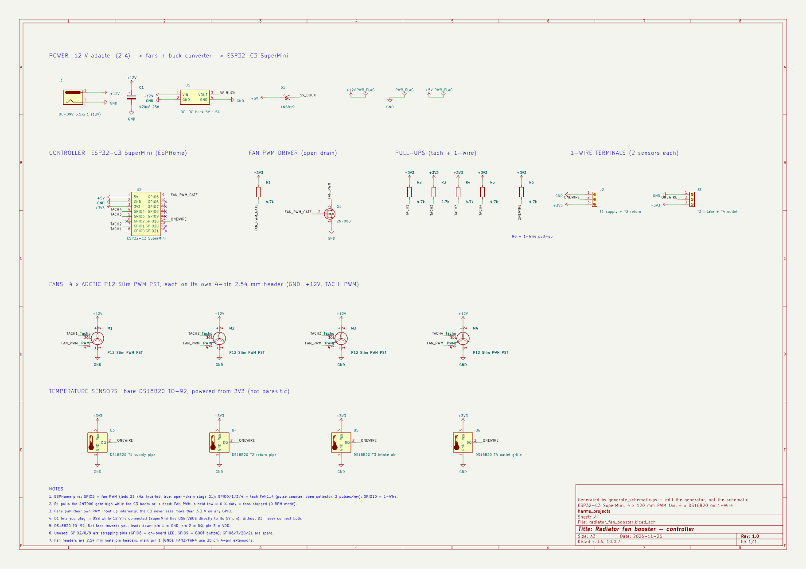
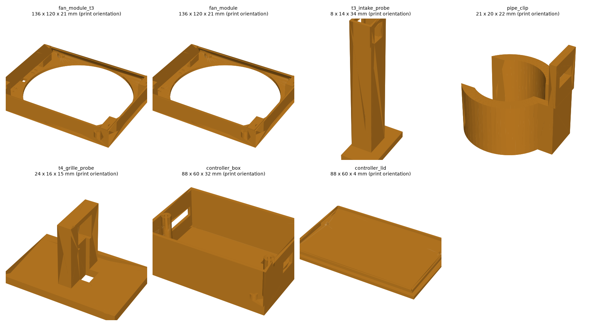
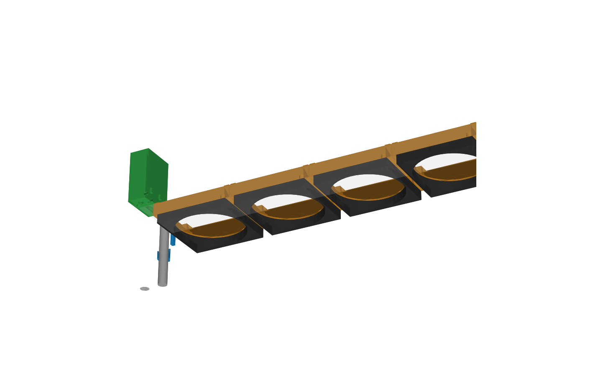

# Radiator Fan Booster – kitchen utility room (bijkeuken)

Smart, quiet fan unit that mounts magnetically under the Radson radiator in the
kitchen utility room. It turns the radiator into a low-temperature (LTV) fan convector, so
that it delivers useful heat at the 28–35 °C water temperature the heat pump
runs for the floor heating, **and** returns cooler water to the heat pump.

Status: **step 2 – hardware design, 3D-printable parts and KiCad schematic done.**
Next steps: print and fit-test (the items in [§9](#9-open-items--verify-before-printing)), then
ESPHome firmware and the HA package/dashboard.

| What | File |
|---|---|
| Design (this document) | [README.md](README.md) |
| CAD generator (FreeCAD 1.1, parametric) | [radiator_fan_booster.py](radiator_fan_booster.py), launcher [build_radiator_fan_booster.bat](build_radiator_fan_booster.bat) |
| Print files (generated, git-ignored) | `print/*.stl`, `radiator_fan_booster.step`, `radiator_fan_booster.FCStd` |
| Preview renders | [previews/](previews) ([render_previews.py](render_previews.py)) |
| Schematic (KiCad 10) | [radiator_fan_booster.kicad_sch](radiator_fan_booster.kicad_sch) + project library [radiator_fan_booster.kicad_sym](radiator_fan_booster.kicad_sym), generated by [generate_schematic.py](generate_schematic.py) |

---

## 1. Problem and goal

| Observation | Consequence |
|---|---|
| Water supply 28–35 °C (weather curve + COP optimisation for floor heating) | Radiator barely warm; natural convection collapses at low ΔT |
| Room cold | Needs more heat, overheating is not a concern |
| Heat pump return is **+1.5…1.9 K** higher than the floor-heating return | The radiator branch passes a lot of water with only ~1 K drop → bypass of warm water → lower COP, and the pump's ~5 K ΔT control can't do its job |

Goals, in priority order:

1. **More heat** out of the radiator at 28–35 °C water (target ≥ 2× the current output).
2. **Larger water ΔT across the radiator** (target 4–5 K, like the floor loop), so the
   heat pump return drops back to floor-return level.
3. **Low noise**: "quiet PC" level at all times (silence at night is not required).
4. **Tunable**: fan speed vs noise vs heat output can be explored and set from Home Assistant
   ([§6.4](#64-modes-and-the-experiment-workflow)).
5. Fully automatic and visible in Home Assistant (next to
   [heatpump_monitor](../../home-assistant/heatpump_monitor) and
   [floor_heating_monitor](../../home-assistant/floor_heating_monitor)).

> Goal 2 needs **both** fans and hydraulic balancing. Fans let the radiator release
> more heat. Only throttling the lockshield (return) valve reduces the flow to what the
> radiator can cool down by 4–5 K. The pipe sensors in this design make that balancing
> measurable (see [§6.5](#65-balancing-assistant-cop)).

## 2. Radiator (photos + measurements, 2026-11-26)

| Property | Value | Source |
|---|---|---|
| Make / type | Radson panel radiator, **type 22** (2 panels + 2 convector fin rows, top grille) | photos: top view shows two fin rows |
| Width × depth × height | **600 × 100 × 750 mm** | tape |
| Floor → radiator bottom | **90 mm** | tape |
| Rear panel → wall | **20 mm** | tape |
| Pipes | **15 mm** steel. Supply rises on the left, outside the radiator, to the TRV (top-left side tapping). Return: a short riser from the floor to the bottom-left side tapping | photos, tape |
| Underside | Open between the panels (fin rows visible). Panel bottoms are flat steel seams, which is where the magnets go. Connection nipples between the panels sit just inside each end | underside photos |
| Nominal output (EN 442, 75/65/20 °C) | ≈ 1.25 kW (H750), exponent n ≈ 1.3 | typical type 22 catalogue values |

Natural-convection output now (supply 33 °C, return ≈ 31.5 °C, room ≈ 17 °C → ΔT ≈ 15 K):
`P ≈ P_nom · (15 / 49.8)^1.3 ≈ 0.21 · P_nom` → **≈ 260 W**.

About 70 % of a type 22's output is convection through the fin rows, which is the part fans
can boost. Forced air through the fins typically gives **+50…150 % at low water temperatures**,
so the expected result is **≈ 400–600 W**, set by the fan speed you accept.
The sensors below measure this, so no guessing is needed later.

## 3. System overview

```text
   230 V socket
        │
  [12 V 2 A adapter] ──5.5/2.1 jack──┬──────────────────────────── 12 V rail ───┬──┬──┬──┐
                                     │                                          F1 F2 F3 F4  (pin 2: +12 V)
                              [buck 12→5 V]                                     │  │  │  │
                                     │ 5 V                                      │  │  │  │
                               ┌─────┴─────────────────┐  PWM (25 kHz)  ┌───────┴──┴──┴──┴─┐
                               │ ESP32-C3 SuperMini    │─GPIO5─[2N7000]─┤ pin 4 PWM (all)   │
                               │                       │─GPIO0 ◄────────┤ pin 3 tach F1     │
                               │                       │─GPIO1 ◄────────┤ pin 3 tach F2     │
                               │                       │─GPIO3 ◄────────┤ pin 3 tach F3     │
                               │                       │─GPIO4 ◄────────┤ pin 3 tach F4     │
                               │                       │                └───────────────────┘
                               │                       │─GPIO10 ─ 1-Wire ─┬─ T1 supply pipe
                               │                       │                  ├─ T2 return pipe
                               │  Wi-Fi → ESPHome API  │                  ├─ T3 intake air
                               └───────────────────────┘                  └─ T4 outlet air (top grille)
```

## 4. Hardware design decisions

### 4.1 Fans – 4 × 120 mm, 4-pin PWM, under the radiator, blowing up

| Option | Verdict |
|---|---|
| **4 × 120 mm** | ✅ **chosen.** Matches the 100 mm depth (≈10 mm overhang, put it on the wall side). 4 × 120 = 480 mm on a 150 mm pitch covers the 600 mm width. |
| 3 × 120 mm | Leaves 150 mm gaps: more rpm needed for the same airflow → louder |
| 5–6 × 80/92 mm | Smaller fans need ~1.5–2× the rpm for the same airflow → louder, more tonal |
| 140 mm | Overhangs 40 mm and only 4 fit; no real gain |

Noise rule of thumb: fan noise ≈ **50·log10(rpm ratio)**, and 4 fans add +6 dB compared with one.
Many large fans at low rpm are much quieter than a few fast ones: halving the rpm is about −15 dB.

**Selected fan: ARCTIC P12 Slim PWM PST** ([spec](https://www.arctic.de/en/P12-Slim-PWM-PST/ACFAN00187A))

- 120 × 120 × **15 mm**, which leaves room for intake air even with a small floor gap
- 200–2100 rpm, **0 rpm mode at very low PWM duty** (just under ~5–9 %, per ARCTIC), so no MOSFET is needed in the 12 V line
- Static-pressure optimised (designed for radiators and filters), which suits pushing air through convector fins
- 58.6 m³/h max, 0.12 A at 12 V (≈ 1.4 W) each, 4-pin with separate tach line, fluid dynamic bearing, 6 yr warranty

Alternatives: with 90 mm of floor clearance a 25 mm fan also fits. Set `FAN_T = 25` in the CAD
generator; that leaves 44 mm of intake gap instead of 54 mm.

- **ARCTIC P12 Pro PST** (5-pack €24.99 at Alternate): more airflow and pressure, but its minimum is
  600 rpm (less quiet at the low end) and it weighs 185 g each.
- **Noctua NF-A12x25 PWM** (≈ €32 each): premium-quiet, but about 4× the cost.

Airflow sanity check: at +300 W extra and an air temperature rise of 6 K the unit needs
`300 / (1206 J/m³K · 6 K) = 0.041 m³/s ≈ 150 m³/h` through the fins. That is ≈ 65 % of the
4-fan free-air maximum. In practice the auto-tune ([§6.3](#63-auto-tune-find-the-knee))
will usually settle around 40–70 % duty.

### 4.2 Temperature sensors – 4 × bare DS18B20 (TO-92) on one 1-Wire bus (from stock)

You have 5 bare DS18B20 in stock: 4 are used and 1 is a spare. Each sensor gets its own
3D-printed holder ([§4.6](#46-3d-printed-parts-cad)).

| # | Location | Purpose | Printed holder |
|---|---|---|---|
| **T1** | Supply pipe, ~10 cm below the TRV (top-left) | Driving temperature, heating on/off detection | `pipe_clip`: snaps onto the 15 mm pipe. The flat face of the TO-92 presses on the pipe (with thermal paste). Cover with pipe insulation |
| **T2** | Return riser between the floor and the bottom-left tapping | Water ΔT = T1 − T2, return vs floor return, COP indicator | `pipe_clip` (same part) |
| **T3** | Intake air, left of fan 1, ~14 mm below the fan intake | Room/floor-level air temperature, baseline for air ΔT | `t3_intake_probe`: hangs through a slot in `fan_module_t3`. The plate above shields it from the radiator's radiant heat |
| **T4** | Top grille, middle, sensor ~7–12 mm below the grille top, in the outflow | Air ΔT = T4 − T3 → heat-output index | `t4_grille_probe`: rests on the grille, with its stem in one slot |

Wiring for bare sensors:

- Extend each sensor with 3 twisted 0.14 mm² stranded wires (black GND, yellow DQ, red VDD; see the
  parts list), as in [floorheating-temp-monitor](../../esphome/floorheating-temp-monitor/README.md).
  Put heat-shrink over each solder joint.
- T4's stem is only 2.8 mm thick, so use thin single wires or 3-wire ribbon for the last ~5 cm
  (they run in a groove up the stem).
- Approximate lengths from the controller box: T1 ≈ 0.7 m, T2 ≈ 0.3 m, T3 ≈ 0.4 m, T4 ≈ 1.2 m.
- Wire T1 + T2 into screw terminal J2 and T3 + T4 into J3.

Why 4 rather than 2–3:

- T1 + T2 are the only way to see the water-side effect (goal 2) and to balance the valve.
- T3 + T4 measure the air side directly. Together with fan rpm they give a fast output signal
  for the auto-tune, without a flow meter.
- 3 sensors (dropping T4) would work, but the auto-tune would then rely only on the slow
  and small water ΔT.

Calibration: DS18B20 are ±0.5 K absolute but very repeatable. Before mounting, put all 4
sensors together in an insulated cup of lukewarm water and record their offsets
(exposed as `number` entities in ESPHome). This matters for T1 − T2, which is only a few kelvin.

### 4.3 Controller – ESP32-C3 SuperMini (from stock)

- **Tach counting:** the C3 has no hardware pulse counter (PCNT). ESPHome's `pulse_counter`
  then counts with GPIO interrupts. With 4 fans at ≤ 2100 rpm × 2 pulses/rev that is at most
  ≈ 70 Hz per input, a negligible load.
- **PWM:** one 25 kHz LEDC channel drives all 4 fans in parallel, through a **2N7000 open-drain stage**.
  The fans pull their own PWM input up to 3.3–5 V, so the C3 never sees 5 V.
  - **Gate pull-up 4.7 kΩ to 3.3 V:** while the C3 boots or is dead, the MOSFET is on, PWM is
    held low and the fans are at 0 rpm (quiet failure).
  - The stage inverts the signal, which ESPHome handles with `inverted: true`.
- **Tach:** open-collector, 4.7 kΩ pull-up to 3.3 V each, 2 pulses/rev. Per-fan tach gives
  stall detection and an rpm-to-duty map.
  This is why each fan gets its own header instead of a splitter or the fans' daisy-chain
  plugs, which only pass through one tach signal.
- **Fan headers:** 4 × 4-pin 2.54 mm male pin headers on perfboard. PC fan plugs fit them;
  mark the orientation (pin 1 = GND).
- **Wi-Fi:** some C3 SuperMini batches have a weak antenna layout. If the signal is poor, the
  usual fix is `wifi: output_power: 8.5dB` in ESPHome.
- **Enclosure:** 3D-printed box, magnet-mounted to the left side panel of the radiator next to
  the pipes, which keeps the sensor leads short.

GPIO map (ESP32-C3 SuperMini):

| Function | GPIO | Notes |
|---|---|---|
| Fan PWM (all) | GPIO5 | → 2N7000 gate, 4.7 kΩ pull-up to 3V3; drain → fan pin 4 ×4; source → GND |
| Tach F1…F4 | GPIO0, GPIO1, GPIO3, GPIO4 | external 4.7 kΩ pull-ups to 3V3; no strapping pins used |
| 1-Wire T1…T4 | GPIO10 | 4.7 kΩ pull-up to 3V3, sensors powered from 3V3 (not parasitic) |
| Status LED | GPIO8 | on-board blue LED (inverted). Strapping pin, so leave it otherwise unconnected |
| Manual boost | GPIO9 | on-board BOOT button (short press = 30 min boost). Strapping pin, button only |
| Spare | GPIO2 (strapping, keep it pulled high), GPIO6, GPIO7, GPIO20, GPIO21 | e.g. later a room-height sensor or a display |

USB logging uses the C3's built-in USB-Serial-JTAG, so GPIO20/21 stay free.

### 4.4 Power supply

| Load | Current @ 12 V |
|---|---|
| 4 × P12 Slim at 100 % | 4 × 0.12 A = 0.48 A |
| ESP32-C3 via buck (≈ 150 mA @ 5 V peak during Wi-Fi TX) | ≈ 0.07 A |
| **Total peak** | **≈ 0.55 A** → 12 V **2 A** adapter gives > 3× margin, including fan start-up |

- 12 V / 2 A wall adapter (5.5 × 2.1 mm) → panel-mount DC jack J1 in the controller box → 12 V rail.
- Fixed **12 → 5 V buck module** → Schottky diode D1 → SuperMini `5V` pin. Never feed 12 V into
  it: the on-board LDO is rated only up to about 6 V.
- On the SuperMini, USB VBUS is tied directly to the `5V` pin. **D1 (1N5819)** stops USB and the
  buck feeding each other, so you can plug in USB for logs while 12 V is connected. The diode
  drops ≈ 0.35 V, leaving ≈ 4.65 V for the LDO, which is fine.
- 470 µF/25 V electrolytic C1 across the 12 V rail near the fan headers (fan start-up surge).
- Standby with fans at 0 rpm: ≈ 0.7 W. Full speed: ≈ 7 W.

### 4.5 Electronics schematic (KiCad)

[radiator_fan_booster.kicad_sch](radiator_fan_booster.kicad_sch) is the full circuit on one A3 sheet.
It passes KiCad ERC with **0 errors and 0 warnings** (all severities enabled).



| Ref | Part | Nets |
|---|---|---|
| J1 | DC-099 5.5 × 2.1 panel jack | +12V, GND |
| C1 | 470 µF 25 V | +12V, GND |
| U1 | 12 → 5 V buck module | VIN = +12V, VOUT = 5V_BUCK |
| D1 | 1N5819 | 5V_BUCK → +5V |
| U2 | ESP32-C3 SuperMini | see the GPIO map above |
| Q1 + R1 | 2N7000 + 4.7 kΩ gate pull-up | GPIO5 → FAN_PWM (open drain) |
| R2–R5 | 4.7 kΩ tach pull-ups | TACH1–4 → GPIO0/1/3/4 |
| R6 | 4.7 kΩ 1-Wire pull-up | ONEWIRE → GPIO10 |
| J2, J3 | 3-pin 5.08 mm screw terminals | GND / ONEWIRE / +3V3 (T1+T2, T3+T4) |
| M1–M4 | ARCTIC P12 Slim PWM PST on 4-pin 2.54 mm headers | GND / +12V / TACHn / FAN_PWM |
| U3–U6 | DS18B20 TO-92 (off-board) | GND / ONEWIRE / +3V3 |

The ESP32-C3 SuperMini and the buck module are in the project library
[radiator_fan_booster.kicad_sym](radiator_fan_booster.kicad_sym). [sym-lib-table](sym-lib-table) loads
it when you open [radiator_fan_booster.kicad_pro](radiator_fan_booster.kicad_pro). All other symbols
are standard KiCad 10 library symbols, embedded in the schematic.

Perfboard layout (5 × 7 cm, long side vertical in the box, USB-C at the top):

- **C3 SuperMini:** top edge, centred across the width, in female headers. Its USB-C port lines up
  with the slot in the top wall (USB slot centre 12–20 mm above the box floor; adjust
  `BOX_FLOOR + 12..20` in the CAD if your header height differs).
- **Bottom edge:** left to right, J1 jack wires, C1, U1, then the 4 fan headers and J2/J3, so
  all cables leave through the bottom slot.
- **Keep clear:** the bottom-left corner (~15 × 15 mm from the jack wall, above the board), where
  the DC jack body sits.

### 4.6 3D-printed parts (CAD)

Generated by [radiator_fan_booster.py](radiator_fan_booster.py), a parametric FreeCAD 1.1 script.
Build with:

```powershell
.\projects\hardware\radiator-fan-booster\build_radiator_fan_booster.bat
# optional preview PNGs (uses the shared cad-tools venv + FreeCAD headless):
.\.venvs\cad-tools\Scripts\python.exe .\projects\hardware\radiator-fan-booster\render_previews.py
```



| Part (`print/*.stl`) | Qty | Size (mm) | Purpose |
|---|---|---|---|
| `fan_module` | 3 | 136 × 120 × 21 | Fan plate + plenum, 4 magnet pads, slanted rear deflector |
| `fan_module_t3` | 1 | 136 × 120 × 21 | Same, plus a slot for the T3 probe. Goes leftmost, next to the pipes |
| `t3_intake_probe` | 1 | 8 × 14 × 34 | Flange rests on the plate inside the plenum; the stem hangs through the slot |
| `pipe_clip` | 2 (+1 spare) | 21 × 20 × 22 | Snap-on clip for the 15 mm pipe (T1, T2), with a zip-tie tab for strain relief |
| `t4_grille_probe` | 1 | 24 × 16 × 15 | Saddle on the top grille, stem through one slot |
| `controller_box` + `controller_lid` | 1 + 1 | 88 × 60 × 32 / 88 × 60 × 4 | Holds the 70 × 50 perfboard on 4 standoffs (M2 × 5–8 screws, 7 mm deep pilot holes). The lid uses 2 × M3 × 10 screws; both thread into printed pilot holes |



How it fits (all checked in the script; the interference report is 0.000 mm³ for every pair):

- **Height stack** under the radiator: magnet pads touch the radiator bottom (z = 0).
  - The plate is at −18…−21 mm and the fan at −21…−36 mm.
  - This leaves **54 mm of intake gap** above the floor (90 mm clearance).
- **Module row:** 4 × 136 mm = 544 mm, centred under the 600 mm radiator (28…572 mm), clear of the
  end connections.
- **Depth:** the fan sits flush with the radiator front (2 mm proud) and ends 2 mm from the wall.
  - The **slanted rear deflector** closes the 20 mm wall gap. Air coming off the back half of the fan
    is turned forward into the fins instead of rising behind the radiator, which would heat the
    outside wall.
  - The slope is 47° from vertical, so it prints without supports.
- **Magnets:** 16 of your **Tonzon 8 × 4 × 3 mm** blocks (4 per module) slide into side slots in the
  pads. They sit 0.6 mm under the contact face, so no paint scratches, and they can't fall out even
  if the glue fails.
  - Fix each with a drop of CA glue.
  - The pads sit under the **front and rear panel seams** (y = −2…18 and 81…99 mm); the walls stay
    1 mm below the contact plane, so only the pads touch.
- **Fan mounting:** screws go up through the fan frame into Ø3.2 pilot holes in printed bosses (4 per fan).
  - Use the fan's long screws or 6-32 / M3.5 × ~25 mm self-tapping screws.
  - The fans can be swapped without touching the magnets.
- **Cables:** zip-tie slot pairs in the plate margins (between the fans) carry the fan and T3 cables
  to the left end. FAN3/FAN4 need a 30 cm 4-pin extension.
- **Controller box:** 4 more Tonzon magnets in floor pockets (0.6 mm skin) hold it to the **left side
  panel** of the radiator, below the TRV, between the side panel and the supply pipe.
  - Cables leave at the bottom (DC jack Ø8.2 + 28 × 7 mm slot); USB-C is at the top.
- **Materials and print settings:**
  - **PETG or ASA**, not PLA. The hybrid's gas boiler can deliver much hotter water than 35 °C, and
    PLA creeps above ~50 °C.
  - 0.2 mm layers, 4 perimeters, 20 % infill.
  - All parts print without supports in the exported orientation.

Key parameters at the top of the script: `FAN_T`, `FLOOR_GAP`, `WALL_GAP`, `PIPE_D`,
`MAG_L/W/T`, `GRILLE_SLOT_W`, `T4_DEPTH`, `MODULES_X0`, `BOARD_HOLE_INSET`, `DC_JACK_D`.

## 5. Expected effect on the heat pump

- Radiator output ≈ ×1.5–2.5 at the same water temperature, so the room warms up without
  raising the weather curve for the whole house.
- After balancing to ΔT 4–5 K, the radiator return roughly matches the floor return, and the
  heat pump return (`sensor.bridge0_sensors_temperature_r4t_return_water`) should drop by
  about the 1.5–1.9 K penalty seen today.
  That is worth roughly a few % in COP, and it lets the Daikin's ΔT pump control work as intended.

## 6. Control algorithm

Runs **locally in ESPHome**, every 10 s, so it keeps working without HA. HA only provides
optional inputs and tuning values.

### 6.1 Signals

| Name | Definition |
|---|---|
| `dT_drive` | T1 − T3 (radiator water vs intake air) – how much heat is available |
| `dT_water` | T1 − T2 – water-side cooling, ∝ heat output at constant flow |
| `dT_air` | T4 − T3 – air heating through the radiator |
| `Q_idx` | (rpm_avg / rpm_max) · dT_air – relative convective output (∝ airflow × ΔT) |
| `P_est` | optional W estimate: fans-off EN 442 output × (dT_water / dT_water at fans off) |

### 6.2 State machine (mode **Auto**, default)

```text
OFF ──(dT_drive ≥ 4 K for 2 min)──► RUN ──(dT_drive < 2.5 K for 5 min)──► OFF
```

Heating off, DHW-only or defrost all mean no warm water, so the fans stay at 0 rpm and
never blow cold air. In RUN:

```text
demand   = lerp(dT_drive, 4 K → 25 %, 12 K → 100 %)   # more ΔT → more W per rpm → worth the noise
cap_max  = max_duty (HA number, default 70 % ≈ quiet-PC level; tune it in §6.4)
cap_time = quiet_duty during optional quiet hours (default OFF), else 100 %
cap_knee = knee duty from auto-tune (default 100 % until tuned; can be disabled)
cap_room = 100 %, P-reduced when HA room temperature > room_max (optional, default off)
target   = min(demand, cap_max, cap_time, cap_knee, cap_room)
duty     = slew(target, +1 %/5 s, −2 %/5 s)            # inaudible ramps; kick 40 % for 2 s when starting from 0
```

Below ~10 % duty the fans are in their 0-rpm zone, so the minimum running duty is 15 %.

### 6.3 Auto-tune: find the "knee"

Output rises with fan speed with diminishing returns, while noise keeps rising at ≈ 50·log10(rpm).
The useful optimum is the point where extra rpm buys little extra heat.

1. Runs on demand (HA button) or at most once a day at a configurable daytime hour, only when
   T1 has been stable (±0.5 K over 30 min).
2. It steps the duty 0 → 20 → 35 → 50 → 65 → 80 → 100 %, dwelling 10 min at each step
   (the radiator time constant). For each step it averages the last 3 min of
   `Q_idx / dT_drive` and `dT_water / dT_drive`. Normalising by `dT_drive` cancels drift in
   the supply temperature.
3. It fits a saturating curve `G(d) = Gmax · (1 − e^(−d/τ))`.
4. **Knee duty** = lowest duty reaching **η · Gmax**, where η = "efficiency" slider, default **85 %**.
   Typically this is ~85 % of the maximum heat at ~55–65 % rpm, about 10 dB quieter than full speed.
5. The result is stored in flash (`restore_value`) and published to HA together with the
   duty/rpm/gain table for a dashboard chart.

### 6.4 Modes and the experiment workflow

| Mode | Behaviour |
|---|---|
| **Auto** | §6.2 + §6.3 (max efficient output within `max_duty`) |
| **Return target (COP)** | PI loop raises the duty until T2 ≤ HA `sensor.floor_heating_return_temperature` + 0.5 K (or T1 − 5 K without HA), still bounded by `max_duty` |
| **Manual** | Fixed duty from an HA slider (0–100 %), applied immediately. For listening tests |
| **Sweep** | Automatic step test with configurable steps (default 0/20/35/50/65/80/100 %) and dwell (default 10 min), publishing a result per step (see below) |
| **Boost** | 100 % for 30 min (BOOT button / HA), then back to the previous mode |
| **Off** | 0 % |

**Playing with speed vs noise vs heat.** For each duty level (Manual or Sweep), ESPHome publishes:

- the duty and the average fan rpm;
- **relative noise** = 50·log10(rpm / 600 rpm) dB, the fan-law estimate;
- `dT_air`, `Q_idx`, `dT_water` and `P_est` (≈ W).

Then:

1. A phone sound-meter app at 1 m gives the real noise. Enter its reading in the HA number
   `measured noise dB(A)`, and HA stores it with that step.
2. The dashboard plots **heat gain vs duty**, with the noise on a second axis, so the knee and your
   personal "too loud" point are visible.
3. Set **`max_duty`** to taste (the noise ceiling). Optionally set the auto-tune efficiency η, or
   disable the knee cap if you simply want maximum heat up to `max_duty`.

Quiet hours stay available (a toggle, a time window and `quiet_duty`), but they are **off by
default**: quiet-PC level all the time is the target.

Optional later upgrade: an I2S MEMS microphone (INMP441) on the spare GPIO6/7/20 could measure
the noise directly for a fully automatic noise-vs-heat sweep. It is not in the current schematic.

### 6.5 Balancing assistant (COP)

The controller publishes a hint, `Radiator flow`: `ok` / `too high` / `too low`.

- **Too high:** in RUN at knee duty with dT_water < 3 K for > 1 h. Close the lockshield
  (bottom-left) a ¼ turn and wait an hour.
- **Too low:** dT_water > 7 K. Open it a little.
- **Ok:** anything in between.

Also set or remove the TRV head so it doesn't fight this. The room is cold and the fans do the
control, so set it to **5 / max**.

### 6.6 Safety and faults

- **Fan stalled:** duty ≥ 25 % with rpm < 150 for 30 s → HA alert.
- **Sensor missing or 85 °C:** fall back to a fixed 35 % if T1 is lost while HA reports space
  heating. Otherwise 0 %.
- **Controller crash/boot:** gate pull-up keeps the fans at 0 rpm, and the watchdog reboots the board.

### 6.7 Home Assistant entities (planned)

- **Sensors:** T1–T4, the 4 fan rpms, duty, `dT_water`, `dT_air`, `Q_idx`, `P_est`, relative
  noise (dB), knee duty, state (OFF/RUN/TUNING/SWEEP), balancing hint, last sweep table
  (JSON attribute).
- **Controls:**
  - `select` mode (Auto / Return target / Manual / Sweep / Boost / Off)
  - `number` max_duty, manual duty, efficiency η, sweep dwell and steps, measured noise dB(A),
    quiet_duty, sensor offsets
  - `switch` knee cap on/off, quiet hours on/off; `time` quiet hours start/end
  - `button` auto-tune / start sweep / boost
- **Imported from HA (optional):** floor return temperature, room temperature, heat-pump
  operating mode (`bridge0_…`).

## 7. Parts list

Prices are incl. VAT, checked 2026-11-26.
**Already in stock:** ESP32-C3 SuperMini, 5 × DS18B20 (TO-92), 20 × Tonzon neodymium magnets 8 × 4 × 3 mm.

**Tinytronics** has every electronic part you still need except quiet 4-pin 120 mm PWM fans: its
largest fans are 80 mm and it has no PC fans. The fans therefore come from **Azerty**.
Equivalent single-shop electronics orders at **Elektronica voor jou** (7.1a) and **Bits & Parts**
(7.1b) are listed as alternatives; all three ship from the Netherlands.

Every product link below was opened and its price and stock read, except:
- the pin-header category page;
- the lines marked "listing only", whose prices were only seen on category listings;
- the lines marked "not verified", which have no checked link.

### 7.1 Tinytronics.nl (one order)

| # | Qty | Part | Link | Price |
|---|---|---|---|---|
| 1 | 1 | Power adapter 12 V 2 A, DC jack 5.5 × 2.1 mm | [tinytronics](https://www.tinytronics.nl/nl/power/voedingen/12v/sunshine-voedingsadapter-met-dc-jack-5.5-2.1mm-12v-2a) | €9.00 |
| 2 | 1 | J1: DC jack 5.5 × 2.1 female, metal panel mount DC-099 – listing only | [tinytronics](https://www.tinytronics.nl/nl/kabels-en-connectoren/connectoren/dc-jack/dc-jack-metaal-5.5x2.1mm-female-mount-dc-099-1) | €0.75 |
| 3 | 1 | U1: DC-DC buck converter, fixed 5 V 1.5 A (7–26 V in) | [tinytronics](https://www.tinytronics.nl/nl/power/spanningsconverters/buck-(step-down)-converters/dc-dc-step-down-buck-converter-1.5a-5v-output) | €3.00 |
| 4 | 2 | Q1: 2N7000 N-MOSFET (1 spare) | [tinytronics](https://www.tinytronics.nl/nl/schakelaars/transistoren-en-mosfet's/mosfet's-fet's/2n7000-fet-60v-200ma) | 2 × €0.50 |
| 5 | 1 | R1–R6: resistor 4.7 kΩ ¼ W, 10 pcs | [tinytronics](https://www.tinytronics.nl/nl/componenten/weerstanden/weerstanden/weerstand-4.7k%CF%89-1-4w-10-stuks) | €0.50 |
| 6 | 1 | D1: Schottky diode 1N5819 (1 A, 40 V) – not verified, search "1N5819" in the shop | Tinytronics | ≈ €0.25 |
| 7 | 1 | C1: electrolytic capacitor 470 µF 25 V – not verified, any ≥ 16 V part | Tinytronics | ≈ €0.50 |
| 8 | 2 | Perfboard 5 × 7 cm double-sided (1 spare) | [tinytronics](https://www.tinytronics.nl/nl/gereedschap-en-montage/prototyping-toebehoren/experimenteer-printplaten/experimenteer-printplaat-5cm*7cm-dubbelzijdig) | 2 × €0.80 |
| 9 | 2 | J2, J3: screw terminal 3-pin 5.08 mm (1-Wire bus) | [tinytronics](https://www.tinytronics.nl/nl/kabels-en-connectoren/connectoren/schroefterminals/3-pin-schroef-terminal-block-connector-5.08mm-afstand) | 2 × €0.80 |
| 10 | 1 | Male pin header 2.54 mm, 40-pin (4 × 4-pin fan headers) + a female header strip for the C3 | [tinytronics – pin headers](https://www.tinytronics.nl/nl/kabels-en-connectoren/connectoren/pin-headers) | ≈ €1.00 |
| 11 | 1 | Dupont jumper wires F-F 20 cm (bench testing) | [tinytronics](https://www.tinytronics.nl/nl/kabels-en-connectoren/kabels-en-adapters/prototyping-draden/dupont-compatible-en-jumper/dupont-jumper-draad-female-female-20cm-10-draden) | €0.75 |
| 12 | 1 | *Optional:* thermally conductive pad 20 × 130 × 1 mm for T1/T2 (or use thermal paste) – listing only | [tinytronics](https://www.tinytronics.nl/nl/gereedschap-en-montage/installatie-en-montagemateriaal/tape/termopasty-ag-thermopad-thermisch-geleidende-dubbelzijdige-tape-6w-mk-20x130x1mm) | €6.00 |
| 13 | 1 | *Optional:* heat-shrink 2:1, 1 m (sensor splices) – listing only | Tinytronics | €1.00 |
| 14 | 3 m | Sensor wire GND: stranded 0.14 mm² Ø1.1 mm, **black**, per metre | [tinytronics](https://www.tinytronics.nl/nl/kabels-en-connectoren/kabels-en-adapters/prototyping-draden/losse-draden/draad-enkeladerig-soepel-%C3%B81.1mm-0.14mm2-zwart-1m) | 3 × €0.60 |
| 15 | 3 m | Sensor wire DQ: same, **yellow** – listing only | [tinytronics](https://www.tinytronics.nl/nl/kabels-en-connectoren/kabels-en-adapters/prototyping-draden/losse-draden/draad-enkeladerig-soepel-%C3%B81.1mm-0.14mm2-geel-1m) | 3 × €0.60 |
| 16 | 3 m | Sensor wire VDD: same, **red** (out of stock on 2026-11-26, 2–4 weeks). Otherwise use any other colour of the same wire | [tinytronics](https://www.tinytronics.nl/nl/kabels-en-connectoren/kabels-en-adapters/prototyping-draden/losse-draden/draad-enkeladerig-soepel-%C3%B81.2mm-0.14mm2-rood-1m) | 3 × €0.60 |
| 17 | 1 | Perfboard screws: bolt M2 × 5 mm, 100 pcs (4 used) | [tinytronics](https://www.tinytronics.nl/nl/gereedschap-en-montage/installatie-en-montagemateriaal/bouten/bout-m2-5mm-draad-100-stuks) | €3.50 |
| 18 | 1 | Lid screws: bolt M3 × 10 mm, 10 pcs (2 used) – listing only | [tinytronics](https://www.tinytronics.nl/nl/gereedschap-en-montage/installatie-en-montagemateriaal/bouten/bout-m3-10mm-draad) | €1.00 |
| | | **Subtotal Tinytronics** | | **≈ €30** (≈ €37 with optionals) + shipping |

How to use these:

- **Sensor wire:** twist the 3 wires together (a drill makes this easy) to get a neat, flexible 3-core
  lead. That is ≈ 2.6 m in total: T1 0.7 m, T2 0.3 m, T3 0.4 m, T4 1.2 m.
- **Screws:** Tinytronics doesn't sell self-tapping screws, but these ordinary M2/M3 machine screws
  cut their own thread in the printed pilot holes (Ø1.7 mm for M2, Ø2.5 mm for M3, already in the
  CAD). Don't overtighten, because the thread is in plastic.

### 7.1a Alternative to 7.1: Elektronica voor jou (Leusden, NL)

All in one order from [elektronicavoorjou.nl](https://elektronicavoorjou.nl); the "#" column refers
to the same item in 7.1.

- **Shipping:** ships the same day if ordered before 16:00. Letterbox from €3.99, parcel €6.45–6.95,
  free from €99.95. Pickup in Leusden is possible.
- **Checked:** every link was opened on 2026-11-26; prices incl. VAT.

| # | Qty | Part | Link | Price |
|---|---|---|---|---|
| 1 | 1 | 12 V 2 A adapter, DC barrel (page doesn't state the plug size; Arduino style = 5.5 × 2.1 mm, check on arrival) | [evj](https://elektronicavoorjou.nl/product/arduino-uno-wandadapter-12v-2a-voeding-dc-barrel) | €6.95 |
| 2 | 1 | J1: panel-mount 2.1 mm DC barrel jack (nut, panels ≤ 8 mm) | [evj](https://elektronicavoorjou.nl/product/panel-mount-2-1mm-dc-barrel-jack) | €1.95 |
| 3 | 1 | U1: Mini MP1584 buck module, **adjustable**. **Set it to 5.0 V with a multimeter before connecting the C3** (no fixed 5 V module in stock) | [evj](https://elektronicavoorjou.nl/product/mini-mp1584) | €1.95 |
| 4 | 2 | Q1: 2N7000 | [evj](https://elektronicavoorjou.nl/product/n-channel-mosfet-2n7000) | 2 × €0.40 |
| 5 | 12 | R1–R6: **no 4.7 kΩ sold singly.** Use 2 × 10 kΩ in parallel per position (= 5 kΩ, fine for all six). The page wasn't opened, so check the 10 kΩ link. The E-12 kit (`1-4w-weerstand-kit-e-12-610pcs`, €10.85) is an alternative | [evj](https://elektronicavoorjou.nl/product/10k-ohm-weerstand) | 12 × €0.10 |
| 6 | 1 | D1: 1N5819. **Out of stock on 2026-11-26.** Back-order it, or fit a wire link and never plug in USB while 12 V is on | [evj](https://elektronicavoorjou.nl/product/1n5819-diode-40v-1a) | €0.19 |
| 7 | 1 | C1: 470 µF 25 V | [evj](https://elektronicavoorjou.nl/product/condensator-470uf-25v) | €1.15 |
| 8 | 2 | Prototyping board 5 × 7 cm, double-sided | [evj](https://elektronicavoorjou.nl/product/prototyping-board-5x7cm-dubbelzijdig) | 2 × €1.49 |
| 9 | 2 | J2, J3: KF301-3P screw terminal, 5.08 mm | [evj](https://elektronicavoorjou.nl/product/kf301-3p-schroefterminal-3-weg) | 2 × €0.49 |
| 10 | 1 + 1 | 40-pin male header + 2 × 40 female header (the 1 × 40 is out of stock; cut 2 × 8 pieces with a fine saw, or solder the C3 directly) | [male](https://elektronicavoorjou.nl/product/pin-header-40), [female](https://elektronicavoorjou.nl/product/80-pins-2x40-female-header) | €0.40 + €1.45 |
| 11 | 1 | Jumper wires F/F 20 cm, 40 pcs | [evj](https://elektronicavoorjou.nl/product/premium-jumper-wires-40stuks-20cm-f-f) | €2.95 |
| 12 | 1 | *Optional:* thermal paste 15 g (the thermal pad is out of stock) | [evj](https://elektronicavoorjou.nl/product/heatsink-silicone-thermal-paste-grease-15g) | €5.45 |
| 13 | 1 m | *Optional:* heat-shrink 2.5 mm, black, per metre | [evj](https://elektronicavoorjou.nl/product/krimpkous-zwart-2-5mm-per-meter) | €0.85 |
| 14–16 | 3 | Sensor wire: 26 AWG silicone hook-up wire, 7.5 m spools. Red and black are out of stock, so use **yellow (DQ), green (GND), white (VDD)**. Solid core: fine for a fixed installation | [yellow](https://elektronicavoorjou.nl/product/aansluitdraad-geel-26-awg), [green](https://elektronicavoorjou.nl/product/aansluitdraad-groen-26-awg), [white](https://elektronicavoorjou.nl/product/aansluitdraad-wit-26-awg) | 3 × €3.45 |
| 17 | 1 | M2 × 6 mm bolts, 10 pcs (machine screw, threads into the pilot hole) | [evj](https://elektronicavoorjou.nl/product/bout-m2-6mm-10-stuks) | €1.65 |
| 18 | 2 | M3 × 10 mm brass pan-head screws | [evj](https://elektronicavoorjou.nl/product/messing-kruiskopschroef-m3-10mm) | 2 × €0.15 |
| | | **Subtotal Elektronica voor jou** | | **≈ €35** (≈ €41 with optionals) + shipping |

### 7.1b Alternative to 7.1: Bits & Parts (Purmerend, NL)

All in one order from [bitsandparts.nl](https://www.bitsandparts.nl); the "#" column refers to the
same item in 7.1.

- **Shipping:** PostNL, usually the same or the next working day if ordered before 16:00. Letterbox
  €2.95 (free from €30), parcel €3.95 (free from €80).
- **Checked:** every link was opened on 2026-11-26; prices incl. VAT.

| # | Qty | Part | Link | Price |
|---|---|---|---|---|
| 1 | 1 | 12 V 1.5 A switching adapter, 5.5 × 2.1 mm (1.5 A is plenty for the 0.55 A load). **Out of stock on 2026-11-26.** Get the adapter from 7.1 or 7.1a if it isn't back | [b&p](<https://www.bitsandparts.nl/voeding-adapter-12-volt-1-5a-gelijkspanning-schakelend-p103001>) | €8.95 |
| 2 | 1 | J1: panel-mount jack 2.1 × 5.5 mm, metal | [b&p](<https://www.bitsandparts.nl/chassisdeel-2-1x5-5mm-voedings-stekker-jack-plug-metaal-p1934378>) | €1.95 |
| 3 | 1 | U1: buck converter, fixed 5 V 3 A, 6–24 V in | [b&p](<https://www.bitsandparts.nl/buckconverter-step-down-dc-dc-uin:6-24v-uout:5v-3a-p1930847>) | €1.95 |
| 4 | 2 | Q1: 2N7000 | [b&p](<https://www.bitsandparts.nl/transistor-n-mosfet-60v-200ma-2n7000ta-p115158>) | 2 × €0.18 |
| 5 | 10 | R1–R6: 4.7 kΩ ¼ W (€0.08 each from 10 pcs) | [b&p](<https://www.bitsandparts.nl/weerstand-4-7k-4k7-ohm-1-4w-5pct-p101760>) | 10 × €0.08 |
| 6 | 1 | D1: 1N5819 Schottky | [b&p](<https://www.bitsandparts.nl/diode-1n5819-schottky-40v-1a-p1934016>) | €0.25 |
| 7 | 1 | C1: 470 µF 35 V (no 25 V version) | [b&p](<https://www.bitsandparts.nl/condensator-470enmicro;f-35v-p121026>) | €0.35 |
| 8 | 2 | Prototyping board 5 × 7 cm, FR4, double-sided | [b&p](<https://www.bitsandparts.nl/prototyping-board-pcb-fiberglass-glasvezel-(18x24gaats-5x7cm)-p106049>) | 2 × €0.79 |
| 9 | 2 | J2, J3: screw terminal 3-way, 5 mm pitch (fits 5.08 mm holes for 3 pins) | [b&p](<https://www.bitsandparts.nl/schroefterminal-blocks-3-voudig-recht-p104049>) | 2 × €0.65 |
| 10 | 1 + 1 | 40-pin male header + 40-pin female header | [male](<https://www.bitsandparts.nl/headerpins-male-40-pins-metaal-recht-zwart-p108162>), [female](<https://www.bitsandparts.nl/headerpins-female-40-pins-metaal-p108158>) | €0.25 + €0.95 |
| 11 | 1 | Dupont jumper wires F/F 20 cm, 40 pcs | [b&p](<https://www.bitsandparts.nl/breadboard-jumper-kabeltjes-dupont-20cm-female-female-40x-p1905691>) | €1.85 |
| 12 | 1 | *Optional:* thermal paste 1 g (no thermal pad in stock) | [b&p](<https://www.bitsandparts.nl/koelpasta-thermal-paste-goud-spuit-1g-p1930880>) | €3.95 |
| 13 | 1 | *Optional:* heat-shrink assortment, 100 pcs, 1.5–13 mm | [b&p](<https://www.bitsandparts.nl/krimpkous-assortiment-100-delig-kleur-p101291>) | €3.95 |
| 14–16 | 3 | Sensor wire: 0.2 mm² (24 AWG) stranded, 10 m rolls in **black, yellow, red** | [black](<https://www.bitsandparts.nl/draad-1x0-2mm²-24awg-meeraderige-soepele-kern-10-meter-zwart-p1905580>), [yellow](<https://www.bitsandparts.nl/draad-1x0-2mm²-24awg-meeraderige-soepele-kern-10-meter-geel-p1905578>), [red](<https://www.bitsandparts.nl/draad-1x0-2mm²-24awg-meeraderige-soepele-kern-10-meter-rood-p1905536>) | 3 × €2.50 |
| 17 | 4 | Perfboard screws: **self-tapping** M2 × 8 mm, stainless, pan head (pilot holes are 7 mm deep in the CAD) | [b&p](<https://www.bitsandparts.nl/schroef-parker-kruiskop-rvs-m2-x-8-0mm-met-bolle-kop-p1932655>) | 4 × €0.05 |
| 18 | 2 | Lid screws: M3 × 10 mm, zinc-plated (machine screw) | [b&p](<https://www.bitsandparts.nl/bout-m3x10-verzinkt-p107468>) | 2 × €0.10 |
| | | **Subtotal Bits & Parts** | | **≈ €28.50** (≈ €36 with optionals) + €3.95 shipping |

Comparison for the electronics order (fans and extensions are unchanged):

| Shop | Subtotal (without optionals) | Gaps on 2026-11-26 |
|---|---|---|
| Tinytronics (Eindhoven) | ≈ €30 | Red 0.14 mm² wire (use another colour); D1/C1 links not verified |
| Elektronica voor jou (Leusden) | ≈ €35 | No 4.7 kΩ (use 2 × 10 kΩ), 1N5819 out of stock, adjustable buck, solid-core wire |
| Bits & Parts (Purmerend) | ≈ €28.50 | 12 V adapter out of stock (buy it elsewhere if needed) |

### 7.2 Azerty.nl (fans)

| # | Qty | Part | Link | Price |
|---|---|---|---|---|
| 19 | 1 | M1–M3: ARCTIC P12 Slim PWM PST **3-pack** | [azerty](https://azerty.nl/product/arctic-p12-slim-pwm-pst-ventilator/4802122) | €19.00 |
| 20 | 1 | M4: ARCTIC P12 Slim PWM PST **single** | [azerty](https://azerty.nl/product/arctic-p12-slim-pmw-pst-ventilatorhuis/4419606) | €13.85 |
| | | **Subtotal Azerty** | | **€32.85** |

### 7.3 Alternate.nl (fan extensions)

| # | Qty | Part | Link | Price |
|---|---|---|---|---|
| 21 | 2 | SilverStone CPF03 4-pin PWM extension 30 cm (FAN3, FAN4) | [alternate](https://www.alternate.nl/SilverStone/4-Pin-PWM-verlengkabel/html/product/1120801) | 2 × €4.99 |

Alternate charges €6.95 shipping. To skip this order, splice 30 cm of 4-core cable into the FAN3/FAN4
leads instead (solder + heat-shrink).

Alternative 25 mm fans (set `FAN_T = 25` in the CAD):

- [ARCTIC P12 Pro PST 5-pack – Alternate](https://www.alternate.nl/ARCTIC/P12-Pro-PST-case-fans/html/product/100140642), €24.99
- [Noctua NF-A12x25 PWM – Alternate](https://www.alternate.nl/Noctua/NF-A12x25-PWM-case-fan/html/product/1452322), €31.99 each

### 7.4 Local DIY store / already at home

- Pipe insulation for 15 mm pipe (covers T1/T2), small zip ties (≤ 2.5 mm wide), CA glue for the
  magnets, thermal paste.
- The fans come with screws. If those are too short for the module bosses, use 6-32 or M3.5 ×
  25 mm screws.
- PETG or ASA filament (≈ 250 g for all parts).

**Total to buy ≈ €72** with the Tinytronics electronics order (≈ €79 with optionals; excl. shipping
and filament). With Elektronica voor jou it is ≈ €78, with Bits & Parts ≈ €71.

## 8. Build and bring-up plan

1. **Test prints:** print one `pipe_clip` and one `t4_grille_probe` first and check the snap fit and
   the grille slot. Adjust `PIPE_D`, `GRILLE_SLOT_W` or `T4_DEPTH` and rebuild if needed.
2. **First module:** print one `fan_module_t3` and glue in 4 magnets (same polarity facing up is not
   needed for steel). Hold it under the radiator to check the pads land on the panel seams and that it
   holds with a fan mounted. Then print the other 3 modules.
3. **Electronics:** solder the perfboard per the schematic. Bench test with C3 + 1 fan + 4 sensors and
   check the PWM range, tach and 0-rpm threshold.
4. **Calibrate:** put the sensor offsets in ESPHome (cup of water). Then mount T1/T2 with thermal paste
   and insulation, T3 in its module and T4 on the grille.
5. **Baseline:** log 1–2 days with the fans off: dT_water, dT_air and the heat-pump return penalty.
6. **Run:** fit all modules, run the auto-tune, and balance the lockshield until dT_water ≈ 4–5 K.
7. **Compare:** heat-pump return / COP before and after, in the heatpump_monitor dashboard.

## 9. Open items – verify before printing

| # | Check | CAD parameter (default) |
|---|---|---|
| 1 | Top-grille slot width, and free depth below the grille before the fins start | `GRILLE_SLOT_W` (5.0), `T4_DEPTH` (12) |
| 2 | Panel bottom seams are flat and steel where the pads land (y = −2…18 and 81…99 mm from the front face); end nipples clear at x < 28 / > 572 mm | `FRONT_PAD_Y`, `REAR_PAD_Y`, `MODULES_X0` |
| 3 | Radiator **side panel** is magnetic steel (controller box). Otherwise use Dual Lock / Velcro | – |
| 4 | Perfboard corner-hole inset and the DC-099 thread diameter | `BOARD_HOLE_INSET` (2.0), `DC_JACK_D` (8.2) |
| 5 | Your magnets really are blocks of 8 × 4 × 3 mm | `MAG_L/W/T` (8/4/3) |
| 6 | SuperMini pin order matches the silkscreen (5V, GND, 3V3, 4, 3, 2, 1, 0 / 5…10, 20, 21) | schematic U2 |
| 7 | Actual supply/return pipe positions next to the box (the assembly uses illustrative positions) | `SUPPLY_XY`, `RETURN_XY` |
